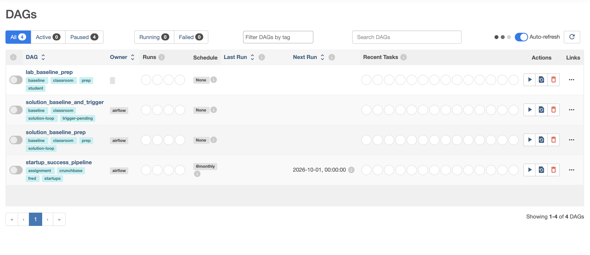
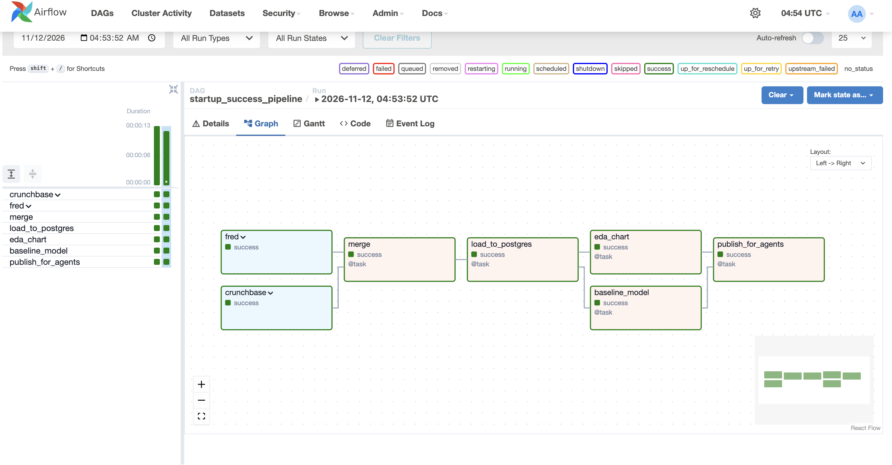
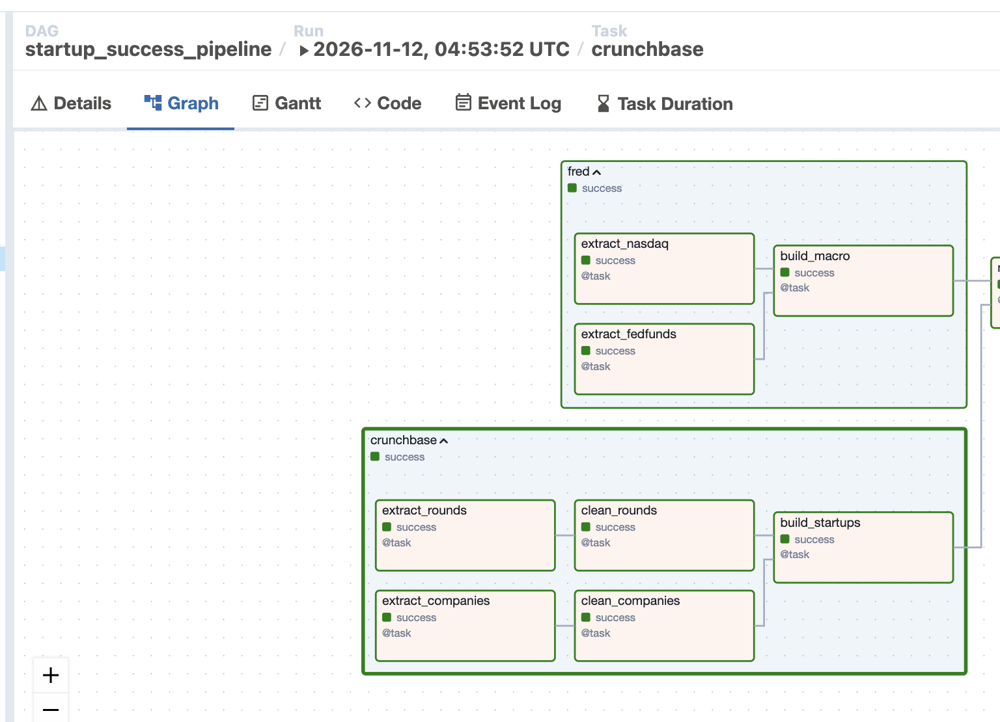
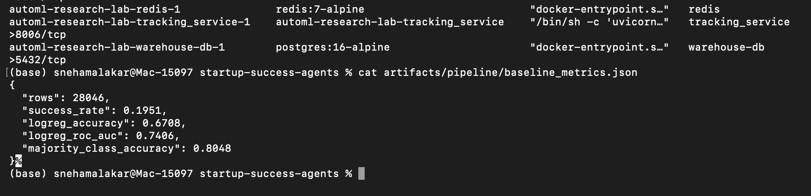
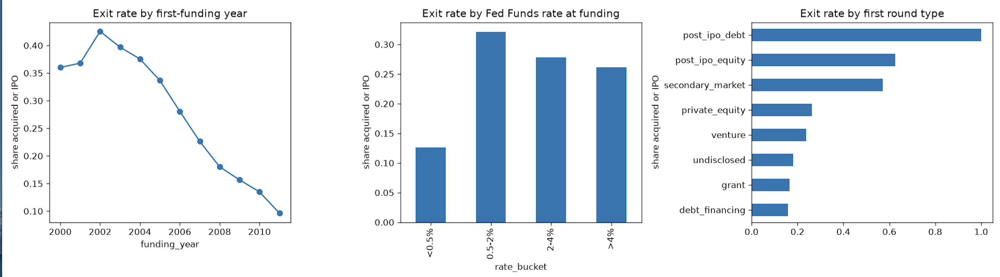
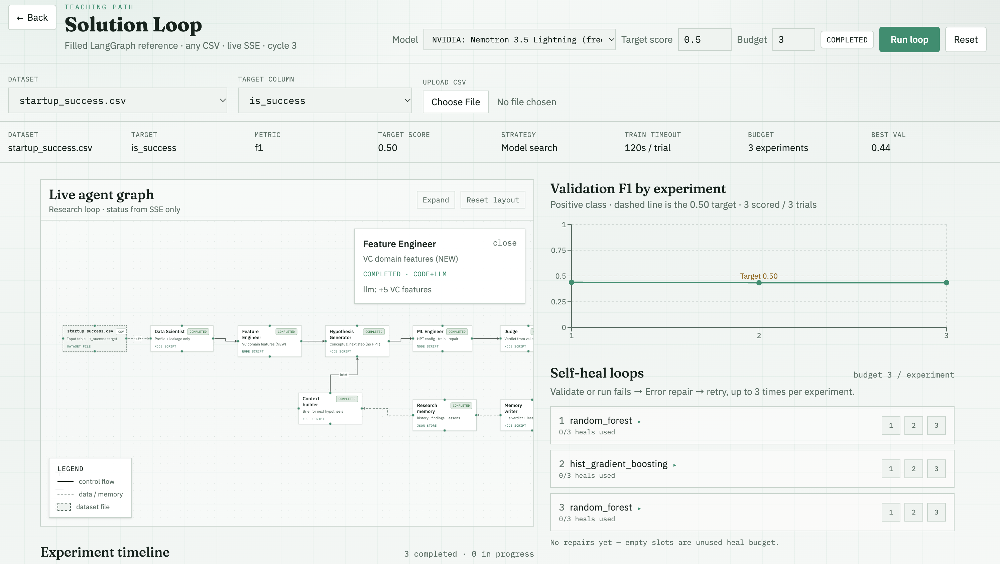
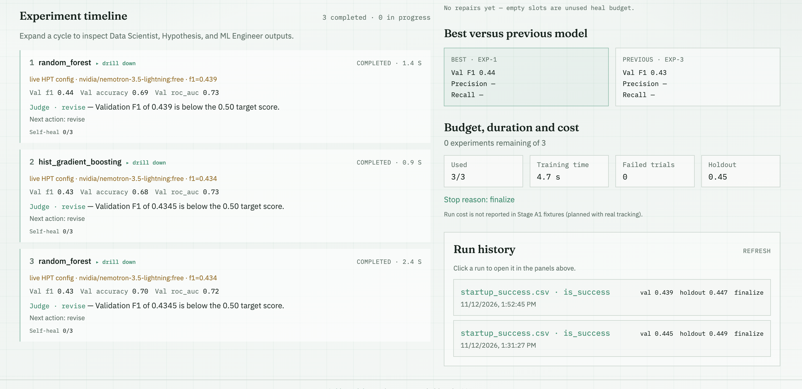
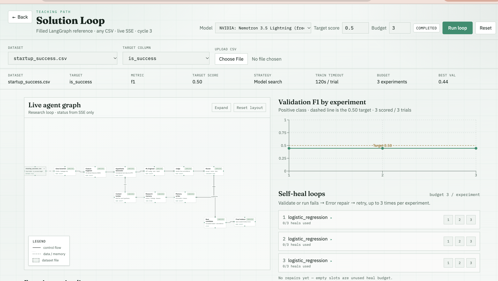
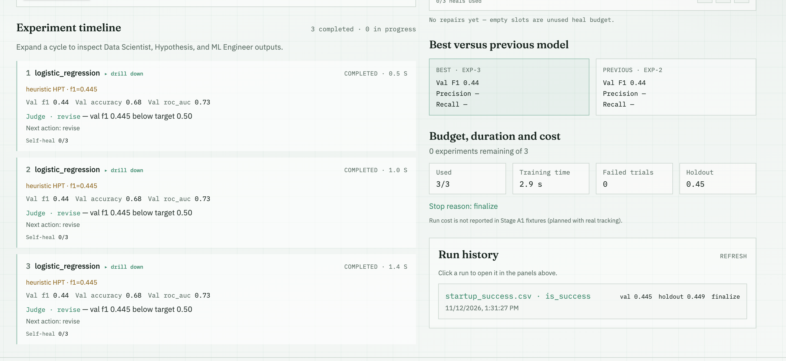

# Startup Success: Airflow Pipeline + Agent-Based ML

**Question:** When a startup raises its **first** funding round, can we predict whether it will eventually be **acquired or IPO**? And does the macro environment at that moment (interest rates, stock market) matter?

This repo contains:
1. **Part 1:** a scheduled **Airflow** pipeline that ingests two distinct datasets, cleans them in parallel, merges them, loads them into **PostgreSQL**, and runs an analysis.
2. **Part 2:** a **LangGraph** agent loop (adapted from the in-class exercise) with a new **Feature Engineer** agent that trains and evaluates models on the cleaned data.

Everything runs in **Docker**.

---

## Quick start

**Prerequisites:** Docker Desktop, Node.js (LTS), a free [OpenRouter](https://openrouter.ai) API key.

```bash
cp .env.example .env
# edit .env and set (no leading '#'):  OPENROUTER_API_KEY=sk-or-v1-...

make start-mac          # Docker services (gateway, agents, ...)   [Windows: make start-windows]
make airflow            # Airflow + Postgres
cd frontend && npm install && npm run dev   # agent UI (keep this terminal open)
```

| What | URL |
|---|---|
| Airflow UI (`admin` / `admin`) | http://localhost:8088 |
| Agent UI (Solution Loop) | http://localhost:5173/solution-loop |
| Warehouse Postgres | `localhost:5433`, user/pass/db = `startups` |

**Run Part 1:** in Airflow, unpause `startup_success_pipeline` and click **▶ Trigger**.
**Run Part 2:** in the agent UI, pick dataset `startup_success.csv`, target `is_success`, target score `0.5`, budget `3`, then **Run loop**.

Stop everything: `make down-mac`

**Tests:** `python -m pytest tests/pipeline` (unit tests for every cleaning/merge step).

**Containerized dev setup:** every service runs from Dockerfiles in `infra/` via `infra/docker-compose.yml`. For an all-in-one editor environment, open the repo in VS Code and choose **Reopen in Container** (`.devcontainer/devcontainer.json`: Python 3.11, Node LTS, Docker access).

---

## Part 1: Airflow data pipeline

### Data sources (two distinct datasets)

| Dataset | Source | Used for |
|---|---|---|
| **Crunchbase** open snapshot: `companies.csv` (66K) + `rounds.csv` (115K) | [github.com/notpeter/crunchbase-data](https://github.com/notpeter/crunchbase-data) | Startup category, country, first round type and size, outcome (acquired / IPO / closed / operating) |
| **FRED** macro series: `FEDFUNDS`, `NASDAQCOM` | [fred.stlouisfed.org](https://fred.stlouisfed.org) | Fed Funds rate and NASDAQ 12-month return in the month of first funding |

### Pipeline structure

DAG: [`pipeline/dags/startup_success_pipeline.py`](pipeline/dags/startup_success_pipeline.py). Transforms: [`pipeline/transforms.py`](pipeline/transforms.py).

```
crunchbase TaskGroup:  extract_companies → clean_companies ─┐
                       extract_rounds    → clean_rounds    ─┴→ build_startups ─┐
fred TaskGroup:        extract_fedfunds ─┐                                    ├→ merge → load_to_postgres
                       extract_nasdaq   ─┴→ build_macro ──────────────────────┘           │
                                                    ┌─────────────────────────────────────┤
                                                    ▼                                     ▼
                                               eda_chart                          baseline_model
                                                    └──────────────┬──────────────────────┘
                                                                   ▼
                                                         publish_for_agents (CSV for Part 2)
```

### Transformations

| Step | What | Why |
|---|---|---|
| `clean_companies` | Dedupe, parse dates, null out impossible dates (e.g. year 0011), label `is_success = status ∈ {acquired, ipo}` | Clean, unambiguous target |
| `clean_rounds` | Keep each company's **first** round only | We predict *at* first funding; later rounds would leak the future |
| `build_startups` | Join company + first round; keep first funding in **2000–2011**; drop `post_ipo_*` / `secondary_market` first rounds; engineer round size (log), time from founding, top-15 category, US flag | The snapshot ends ~2015, so every startup gets 4+ years to exit. Post-IPO "first rounds" are already-public companies (they leak the outcome). |
| `build_macro` | FRED → monthly; NASDAQ 12-month return | Macro environment at funding time |
| `merge` | Join on first-funding month | Combines both datasets |
| `load_to_postgres` | Table `startup_success` in a dedicated `warehouse-db` | Separate from Airflow's metadata DB |

**Leakage control:** features use only information known at first funding. Total funding and number of rounds are deliberately excluded.

### Scheduling and parallel processing

- **Schedule:** `@monthly` (FRED updates monthly), `catchup=False`, `max_active_runs=1`, 2 retries per task (downloads can fail).
- **Parallelism:** the two TaskGroups have no dependency on each other, so Crunchbase and FRED run **at the same time**. Inside each group the two extracts also run in parallel. After loading, `eda_chart` and `baseline_model` both read from Postgres **in parallel**.

### Analysis results

Both analysis tasks read the cleaned data **from Postgres**.

- **~28,000 startups**, **19.5%** exited (acquired or IPO)
- Baseline logistic regression (class-balanced): **ROC-AUC 0.74**, accuracy 0.67 vs. 0.80 for "always predict fail"
  - Accuracy is misleading at a 20% base rate: always predicting "fail" scores 80% but finds zero winners. **ROC-AUC** (ranking quality) is the right metric here.
- **Findings (EDA chart):**
  - Exit rates fall for later cohorts (42% in 2002 → 10% in 2011). Younger companies have had less time to exit, so `funding_year` is kept as a control.
  - Startups first funded when rates were **near zero (<0.5%)** exited **less** often (~13% vs. 26–32%), consistent with easy money funding weaker companies.

### Screenshots

| DAG list | DAG graph |
|---|---|
|  |  |

**TaskGroups expanded (parallel tasks):**


**Baseline metrics + EDA chart** (EDA screenshot from the first run, before the post-IPO filter was added; current chart: `artifacts/pipeline/eda_exit_rates.png`):



---

## Part 2: Agent-based ML workflow

Based on the in-class LangGraph Solution Loop ([`solution/langgraph/graph.py`](solution/langgraph/graph.py)), using the cleaned table exported by `publish_for_agents`.

### Agent graph

```
startup_success.csv → Data Scientist → Feature Engineer (NEW) → Hypothesis Generator → ML Engineer → Judge → Router
                                                                      ↑                                   │ revise
                                                               Context Builder ← Research Memory ← Memory Writer
                                                                                                          │ accept / budget used
                                                                                              Best Candidate → Final Holdout
```

### Modifications

| Change | File | Why |
|---|---|---|
| **New agent: Feature Engineer** | `solution/langgraph/graph.py` | Adds venture-capital domain knowledge. The LLM chooses from a fixed menu of 6 explainable features (e.g. `easy_money_regime` = Fed Funds <2% and NASDAQ up; `is_seed_or_angel`; `large_first_round` ≥ $5M) and explains why. A fixed menu means the LLM can't produce broken code; without an API key it falls back to enabling all features. |
| Live graph updated | `frontend/src/graph/simpleLoopConfig.ts`, gateway | New node and edges appear in the live agent graph |
| **ROC-AUC** added to metrics | `loop_runtime.py` | Appropriate for the imbalanced target |
| Class-balanced gradient boosting, scaled numeric features, dense one-hot | `loop_runtime.py` | Handles the 20% base rate; fixes logistic regression non-convergence and a gradient-boosting crash on sparse input |
| Target score 0.5 (F1 on the positive class) | UI | 0.8 is unrealistic for a 20% base-rate problem |

### Results

| Run | Feature Engineer | Models tried | Best val F1 | Val ROC-AUC | **Holdout F1** |
|---|---|---|---|---|---|
| Heuristic (no LLM) | all 6 features | logistic regression ×3 | 0.445 | 0.73 | **0.449** |
| LLM (Nemotron 3.5, free) | LLM chose 5 of 6 | random forest → gradient boosting → random forest | 0.439 | 0.73 | **0.447** |

**Key findings**
1. **No overfitting:** holdout F1 matches validation F1 in both runs.
2. **The LLM agents explored more:** they switched model families instead of repeating one, but **every family converged to F1 ≈ 0.44 / ROC-AUC ≈ 0.73**.
3. **The ceiling is information, not the algorithm.** What is knowable at first funding (category, round size, macro conditions) predicts exits only moderately. Better *features*, such as founder track record or investor quality, would move the needle more than better *models*.
4. **Limitation of the simple loop:** the Judge only says "revise" when below target and has no strategy for a plateau, so it spends the full budget on near-identical scores.

### Screenshots

**LLM run: live agent graph (Feature Engineer: "llm: +5 VC features")**


**LLM run: experiment timeline and holdout**


**Heuristic run (for comparison)**



---

## Repo layout (main files)

```
pipeline/
  dags/startup_success_pipeline.py   # Part 1 Airflow DAG
  transforms.py                      # pure pandas transforms (unit-tested)
tests/pipeline/test_transforms.py    # unit tests
solution/langgraph/graph.py          # Part 2 agent graph (+ Feature Engineer)
loop_runtime.py                      # shared model training / metrics
frontend/                            # live agent graph UI
infra/docker-compose.yml             # all services incl. Airflow + warehouse-db
infra/Dockerfile.airflow             # Airflow image (+ matplotlib, pinned pandas)
.devcontainer/devcontainer.json      # containerized dev environment
docs/screenshots/                    # submission screenshots
```

## Credits

Infrastructure (Docker services, agent UI, base LangGraph loop) adapted from the course template [Kedar-V/automl-research-lab](https://github.com/Kedar-V/automl-research-lab) (see `TEMPLATE_README.md`). The pipeline, datasets, Feature Engineer agent and analysis are original to this project.
